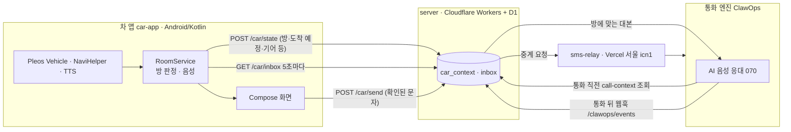

# 내비서 — 차 한 대, 세 개의 방

> 눈은 도로에, 일은 목소리로. 기어·내비 목적지·시각으로 지금 차가 **5분 사무실(정차) / 업무 운전 / 업무 시간 밖(퇴근길)** 중 어느 방인지 판정하고, 방에 맞게 차 화면·음성 안내·전화 응대 말투를 바꾸는 Pleos Connect 앱. 안전 원칙은 **운전 중 화면·휴대폰을 쳐다보는 것을 줄인다**이다. 통화·짧은 음성 대화는 막지 않고, 읽을 것·누를 것을 음성으로 바꾼다.

**시연 영상(4분 33초)**: https://youtu.be/iSY_78r14Xs — 설명란에 장별 시각이 있다.

## 저장소 안내 — 먼저 볼 곳
| 폴더 | 내용 | 먼저 볼 파일 |
|---|---|---|
| `car-app/` | 차 앱(심사 대상 APK). Kotlin 18개 파일, 단위 테스트 176개 | `RoomStateMachine.kt`(방 판정, 순수 Kotlin) → `CarAdapters.kt`(Pleos SDK 호출이 모인 곳) → `RoomService.kt`(중심 서비스, 파일 머리에 읽는 순서) |
| `server/` | Cloudflare Workers + D1. TypeScript 8개 파일 | `src/script.ts`(응대 대본) → `src/index.ts`(경로별 처리, `fetch` 맨 위에 경로 목차) → `src/guard.ts`(AI 문장 검사) |
| `phone-app/` | 안드로이드 폰 연결 앱(메시지 알림 전달·하차 카드) | `Relay.kt`, `Listener.kt` |
| `sms-relay/` | 문자 중계 함수 1개(Vercel 서울 리전) | `api/send.js` |
| `docs/ARCHITECTURE.md` | 파일별 역할과 데이터 흐름 4가지 | — |

- 아래 [Pleos SDK·차량 데이터 사용 표](#pleos-sdk차량-데이터-사용-표)가 SDK 호출과 파일을 잇는 색인이다.
- 코드 주석의 `F6`·`H7`·`O4`·`B안` 같은 표기는 개발 중 쓴 설계 항목 번호이고, `11-06` 같은 날짜는 그 동작을 실측한 날이다. `한계:`로 시작하는 주석은 일부러 단순하게 둔 곳과 그 한도를 적은 것이다.
- 하지 못한 것·확인하지 못한 것은 [알려진 제약](#알려진-제약)에 모았다.

## 문제와 해결
| 문제 | 내비서의 해결 |
|---|---|
| 운전 중 업무 전화가 오면 받자니 위험하고, 안 받자니 상대가 기다린다 | 운전 중 못 받은 전화는 AI 비서가 대신 받아 "운전 중이라 정차 후 연락드리겠습니다"처럼 방에 맞게 응대하고 요약 카드로 남긴다 |
| 통신사 AI 비서는 내가 운전 중인지, 퇴근길인지 모른다 | 차 앱이 기어·목적지·도착 예정·동승자 여부 등을 서버에 올리고, 통화 직전 서버가 그 상태로 응대 대본을 고른다(운전 시간은 상대에게 말하지 않는다) |
| 운전 중 화면을 들여다보면 위험하다 | 주행 중엔 상태 링·숫자와 음성 한 줄만. 카드 확인·문자 답장은 기어 P일 때만, 문자를 음성으로 보낼 땐 내용을 읽어 주고 "응"일 때만 |
| 운전 중 폰 메시지 알림을 볼 수 없다 | 차가 방·운전 상황으로 **언제·무엇을 읽을지** 정해 "카톡 3건, 김민수님 외 2명. 읽어드릴까요?"로 묻고, "읽어줘"·"답장, ○○라고 해 줘"·"나중에"로 답한다 |
| 퇴근 뒤에도 업무가 따라온다 | 퇴근길엔 급한 전화·바로 연결 번호만 알리고, 나머지와 "내일 아침에"로 미룬 카드는 다음 첫 업무 운전에 "어제 넘긴 전화 N건"으로 묶어 알린다 |
| 오래 운전하면 지친다 | 연속 운전 2시간이면 휴게소를 한 번 권한다(전화·업무 말은 그대로 음성으로 처리). 졸음 확인: 운전 시간·시간대로 위험하면 15분마다 짧게 묻고, 대답이 연속 2번 늦거나 없으면 졸음쉼터를 권한다. 휴식 제안 때 앞쪽 졸음쉼터·휴게소를 내비 경유지로 넣는다 |
| 운전 중엔 끼니·충전·주유를 챙기기 어렵다 | 비서가 먼저 묻고("점심 시간이에요. 근처 식당 찾아드릴까요?", 배터리 20% 이하면 충전소), "배고파"라고만 해도 앞쪽 가게를 찾아 경유지로 넣고 식당·카페면 예약 인원을 물어 AI가 가게에 전화한다 |
| 차에서 내리면 남은 일과 주차 위치를 잊는다 | P로 바꾸면 하차 카드(남은 일 + 주차 위치·메모)를 띄우고 폰 앱에서도 같은 카드를 본다. "주차 지하 2층 B구역"이라고 말하면 메모로 남긴다. 도착 전 "주차 자리 있어?"면 실시간 정보가 있는 공영주차장의 빈자리 수를 읽는다 |

AI 비서는 첫 마디에 AI임과 내용을 기록해 전한다는 점을 밝히고, 약속 확정·회신 날짜·금액·운전자 위치는 말하지 않는다(서버 대본에 고정).

## 구성도

- 통화 음성은 차 앱이 아니라 통화 엔진(ClawOps 070 실통화 채널)이 처리한다(Pleos 공개 SDK에 통화 기능이 없음). 무엇을 말할지는 차가 올린 SDK 값이 정한다.
- 문자 발송은 Workers가 국외 IP라 통화 엔진이 막아서, 서울 리전 Vercel 함수(`sms-relay`)가 대신 보낸다.
- 파일별 역할과 데이터 흐름은 [docs/ARCHITECTURE.md](docs/ARCHITECTURE.md).

## Pleos SDK·차량 데이터 사용 표
모두 실제 코드에 있는 호출이다. 경로는 `car-app/app/src/main/java/ztw/carbiseo/` 기준.

| API | 어디에 쓰나 | 파일 |
|---|---|---|
| Vehicle `getGear().registerGearSelection` / `getCurrentGearSelectionState` | 방 판정의 핵심(P = 5분 사무실), 후진 중 음성 미루기, 카드 칩 "기어 D" | `CarAdapters.kt`, `RoomStateMachine.kt` |
| Vehicle `getTurnSignal().registerTurnSignalState` | 깜빡이 켜진 동안 음성 미루기 | `CarAdapters.kt`, `Drive.kt`(busyManeuver) |
| Vehicle `getSteeringWheel().registerSteeringWheelAngle` | 큰 조향 중 음성 미루기 | `CarAdapters.kt`, `Drive.kt` |
| Vehicle `getOdometer().getTrip{Current,Cumulative,SinceRefill}DrivingTime` + register | 피로 모드(장시간 운전이면 휴게소 안내 + 버튼), 졸음 확인 위험 판정, 통화 카드 칩 "N시간 운전"(상대에게는 말하지 않음) | `CarAdapters.kt`, `Drive.kt`(TripDelta) |
| Vehicle `getSeat().registerSeatOccupancy` / `getCurrentSeatOccupancy` (조수석) | 동승자 감지 시 "동승자 모드로 바꿀까요?" 확인 | `CarAdapters.kt`, `Drive.kt`(SeatEdge) |
| Vehicle `getEvBattery().registerEvBatteryStateOfCharge` / `getEvBatteryStateOfCharge` | 서버로 보내는 차량 맥락(soc), 20% 이하면 충전소 먼저 제안 | `CarAdapters.kt`, `RoomService.kt` |
| Vehicle `getDoor().registerDoorPosition` / `getCurrentDoorPosition` (운전석 `ROW_1_LEFT`) | 기어 P + 운전석 문 열림 = 하차 → 주차 위치를 서버에 한 번 더 올림 | `CarAdapters.kt`, `Drive.kt`(gotOff) |
| Vehicle `getWiper().registerWiperState` / `getCurrentWiperState` (앞유리) | 와이퍼가 켜져 있으면 비 → 지각 음성·문자에 "비가 와서" | `CarAdapters.kt`, `Drive.kt`(rainByWiper·lateSpeech) |
| Vehicle `getSafety().getTelltalesInfo` | 빨간 경고등 안내 — **실차 확장**. 필요한 PRIVATE_CAR_SAFETY 권한은 1차 APK에 넣지 않았다(앱마켓 권한 심사·에뮬 미지원). 조회가 실패하면 멈춘다 | `CarAdapters.kt`, `RoomService.kt` |
| NaviHelper `getDestinationInfo` / `onDestinationInfo`(좌표·이름·`remainTime`) | 목적지가 집·회사인지, 도착 예정 분 → 응대 대본·지각 예측·집 도착 5분 전 안내, 목적지 이름이 식당·주차장류면 예약 문자 초안 제안 | `CarAdapters.kt`, `Drive.kt`(homeSoon·lateBy·reservable) |
| NaviHelper `onCurrentLocationInfo` / `getCurrentLocationInfo` | 현재 위치(앞쪽 휴게소 고르기). FusedLocation은 쓰지 않는다 | `CarAdapters.kt`, `Drive.kt` |
| NaviHelper `onRouteCancelled` / `onRouteEnded` / `onDestinationChanged` / `onWaypointChanged` | 목적지 해제·갱신 | `CarAdapters.kt` |
| NaviHelper `getBookmarkInfo` / `onBookmarkInfo` (HOME·OFFICE) | 집·회사 좌표 자동 설정(회사가 목적지면 저녁에도 업무) | `CarAdapters.kt` |
| NaviHelper `getRecentDestinationInfo` / `onRecentDestinationInfo` | 집 즐겨찾기가 없을 때 이름이 "집"인 최근 목적지 | `CarAdapters.kt` |
| NaviHelper `requestRoute(RouteInfo)` | 정차 화면 일정 카드 "출발" → 그 장소로 경로 | `RoomService.kt` |
| NaviHelper `addWaypoint(RequestWaypointInfo)` | 휴식 제안(음성 "응" 또는 버튼)·"급해요" → 앞쪽 졸음쉼터·휴게소를 첫 경유지로. 근처 찾기·주차 빈자리의 "들를게"도 첫 경유지로(목적지가 없으면 `requestRoute`) | `RoomService.kt` |
| NaviHelper `requestTrip` → `onTripInfo`, `RouteStateInfo` 정체 단계 | 일정 장소로 안 가는 중에도 "지금 가면 늦는지"(2시간 안 일정, 5분마다), 경로가 크게 막히면 먼저 말 걸기 | `CarAdapters.kt`, `Drive.kt`(tripCheckDue·trafficOfferDue) |
| NaviHelper `requestNavigationScreen(SearchPlace / AddHomeFavorite)` | 앞쪽 휴게소를 모를 때 내비 검색, 설정의 "내비 즐겨찾기에 집 추가" | `RoomService.kt` |
| NaviHelper `onCurrentRoadSpeedLimit` / `onCameraAlert` / `onCautionPointInfo` | 과속·주의 경고 테두리, 경고 중 음성 보류 | `CarAdapters.kt`, `Alert.kt` |
| TextToSpeech `Mode.ON_DEVICE` `speak` | 방 전환 안내, 부재중 한 줄 낭독, 휴식·집 문턱 안내, 폰 알림 묶음·낭독 (실패 시 Android TTS로 대체) | `Speaker.kt` |
| SpeechToText `Mode.ON_DEVICE` `request` / `ResultListener` (ko_KR) | 음성 대답: 폰 알림("읽어줘"·"답장 …라고 해 줘"·"응"·"나중에"), 지각 문자·회신 문자·예약 초안·휴식 경유지의 "응/아니", 정차 화면 [말하기]("아까 전화"·"다음 일정"·"급해요"). 안 되면 Android 인식 → P·저속 화면 버튼 | `Voice.kt`, `Notif.kt`, `RoomService.kt` |
| AAOS `CarUxRestrictionsManager` (리플렉션) | 주행 화면 제한(DO) 여부 → 방 판정 보조 | `CarAdapters.kt` |
| AAOS `CarPropertyManager` `PERF_VEHICLE_SPEED` | 속도(Pleos Vehicle SDK에 없음) → 과속 판정 | `CarAdapters.kt` |

의존성: `ai.pleos.playground:Vehicle:2.3.2`, `NaviHelper:3.0.5`, `TextToSpeech:3.3.1`, `SpeechToText:3.3.1`. 차량은 읽기만 하고 제어하지 않는다.

## 방 판정 규칙
`RoomStateMachine.kt`(순수 Kotlin, 단위 테스트 대상).

1. 기어가 P(또는 미확인)이고 주행 제한(DO)도 없으면 → **5분 사무실(PARK)**. 충전 중 읽기 API가 없어 충전도 P로 판단한다.
2. 주행 중이면 아래 중 하나라도 맞을 때 → **업무 시간 밖(DRIVE_REST)**, 아니면 **업무 운전(DRIVE_WORK)**
   - 주말(토·일)
   - 저녁~새벽(업무 끝 시각 이후 ~ 04시). 업무 끝 시각은 설정에서 17·18·19·20시, 기본 18시
   - 이른 아침(04시 ~ 업무 시작 07시)인데 목적지가 집(반경 300m)
   - 단, 목적지가 내비 즐겨찾기 '회사'면 시간과 무관하게 업무
3. 흔들림 방지: 주행 → P는 P가 2초 이어져야 전환, 전환 직후 300ms 안의 되돌림은 무시, 목적지가 사라져도 10초는 직전 목적지 유지(경유지 추가 때의 깜빡임 흡수).
4. 2분 미만 정차(신호 대기 등)는 같은 운전으로 본다 — 휴식 타이머·1회 안내를 리셋하지 않는다.

| 방 | 차 화면 | 새 전화 | AI 응대 말투 |
|---|---|---|---|
| 5분 사무실 | 받아 둔 전화 카드([완료]·[내일 아침에]·전화·문자), 일정 카드("지금 출발"), [말하기] | 소리 없이 카드 | "지금 잠시 자리를 비우셨어요"(저녁·새벽·주말 정차는 업무 시간 밖 대본) |
| 업무 운전 | 상태 링·급한 건 수·도착 예정 | 음성 한 줄 | "지금 운전 중이셔서 정차 후 연락드릴 거예요"(도착 예정은 설정·아는 번호일 때만 "약 N분 뒤 도착하세요") |
| 업무 시간 밖 | 상태 링·다음 출근길에 알릴 건 수 | 급한 전화·바로 연결 번호만 음성 | "오늘 업무는 마치셨어요"(주말 "오늘은 쉬는 날이에요") + "말씀하신 내용 전해 드리겠습니다". 회신 날짜는 약속하지 않음 |

도착 예정은 기본으로 아는 번호(주소록·일정 상대·바로 연결·지난 통화 카드에 이름이 남은 번호)에게만 말하고, 모르는 번호에는 "운전 중"까지만 말한다. 설정 "전화 건 분께 도착 예정 알리기"에서 알리지 않기 / 아는 번호만 / 모두에게를 고른다.

응대 방식은 "AI가 대신 받기"와 "한 마디 안내"(운전 중이라는 한 문장 + 도착 예정만 말하고 끊음) 2가지다. 바로 연결 번호(설정, 최대 10개)는 통화 중에 "바로 연결" 카드가 먼저 뜨고, 쉼터 방에서도 차가 읽는다.

폰 알림: 업무 운전 = 광고((광고) 표기·이름에 '광고') 외 전부 묻기, 업무 시간 밖 = 설정의 즐겨찾기 보낸이만, 나머지는 세울 때 묶어서. 깜빡이·후진·큰 조향·경고·블루투스 통화 중이면 미뤘다가 풀리면 한 번에. 알림은 `phone-app/`(안드로이드 '내비서 연결', 알림 접근 권한)이 메시지형 알림을 모두 서버로 넘기고(광고 판정과 읽을지 말지는 차가 정한다, 30일 뒤 삭제) 답장도 그 알림의 답장 버튼으로 보낸다. 시연용으로 관리 페이지 '시험 알림 보내기'가 같은 경로에 넣는다.

## 11-07 이후 추가 기능
문구는 코드의 TTS 문자열 그대로다(`Drive.kt`).

| 기능 | 동작 | 확인 |
|---|---|---|
| 먼저 말 걸기 | 설정 '먼저 말 걸기' 끄기 / 필요할 때만(기본, 운전 1번에 종류별 1번) / 자주(같은 종류 2시간마다). ①배터리 20% 이하 "배터리가 N퍼센트 남았어요. 근처 충전소 찾아드릴까요?" ②점심 11:30~13:30·저녁 17:30~19:30에 60분 넘게 운전 중이고 목적지가 식당류가 아니면 "점심 시간이에요. 근처 식당 찾아드릴까요?" ③업무 운전 중 다음 일정 장소로 가는데 경로 정체가 최고 단계(HEAVY)이고 일정에 상대가 있으면 "앞이 많이 막혀요. 다음 일정 상대에게 늦을 수 있다고 알릴까요?" ④아래 '출발 때 한 번 묻기'. 끄면 ④와 식당 예약 질문도 하지 않는다 | ①② 에뮬 실측(값은 디버그 주입). ③ 정체 단계 수신만 에뮬 실측 |
| 출발 때 한 번 묻기 | D 기어로 운전이 시작되면(업무·쉼 운전 모두, 운전 1번에 1번) 다음 일정 장소로 가는 중이 아닐 때 "다음 일정 ○○로 안내할까요?". 배터리(전기차)·연료(엔진차)가 20% 이하면 "배터리가 N퍼센트라 가는 길에 충전소도 넣을게요."(엔진차는 연료·주유소)를 붙이고, "응"이면 경로와 함께 가까운 충전소·주유소를 첫 경유지로 넣는다. 동승자가 있거나 '먼저 말 걸기'를 끄면 묻지 않는다 | 단위 테스트(`DriveTest`) |
| 근처 찾기 | "배고파·출출해·뭐 먹지"(식당), "커피 마시고 싶다"(카페), "기름 떨어졌어"(주유소), "충전해야 돼·배터리 부족"(충전소) → "근처 ○○ 찾아드릴까요?" → "응"이면 차 좌표를 서버로 1번 보내 카카오 장소 검색(반경 5km) → 목적지 방향 앞쪽에서 가장 가까운 곳 "○○, N미터예요, 들를까요?" → "응"이면 첫 경유지. 주유소·충전소는 "경로에 넣었어요", 식당·카페는 "○○에 HH:MM쯤 도착해요. 몇 분으로 예약할까요?" → 인원을 말하면 AI 예약 전화 | 실서버 실측(11-07). 식당 경유지 뒤 예약 질문 연결은 에뮬 미실측 |
| 하차 카드 | 주행 → P 전환 때 "남은 일"(할 일·회신할 전화 최대 8건 + "외 N건")과 주차 위치(주소, 메모, "다음 출발 때 지워져요"). 기어 P에서 운전석 문이 열리면 위치를 서버에 한 번 더 올린다. 폰 앱 '내비서 연결'에서도 같은 카드를 보고 할 일을 끝낼 수 있다(`/phone/parked`) | 차 화면 에뮬 실측, 폰 화면 캡처 확인, 차→서버→폰 연동 미실측 |
| 주차 메모 | 말 속 "주차 지하 2층 B구역" → 층·구역만 저장, "주차 위치를 적어 뒀어요". 하차 카드 [메모 남기기] → "어디에 세우셨어요?" 뒤 한 마디(40자) | 에뮬 실측 |
| 주차 빈자리 | "주차 자리 있어?" → 목적지(없으면 현재 위치) 1km 안 최대 3곳의 공공데이터 실시간 값 → "○○에 N자리 남았고 N미터예요, 경유지로 넣을까요?" / "근처 주차장이 다 찼어요" / 정보가 없으면 "가게에 주차 자리 물어볼까요?" → "응"이면 AI가 가게에 지금 주차 자리가 있는지와 주차비를 묻는 전화(예약 전화와 같은 `O4_LIVE`·하루 5통 규칙) | 서버 단위 테스트. 범위는 아래 '알려진 제약' |
| 구글 캘린더 | 폰 앱에서 구글 로그인(`calendar.events.readonly`) → 서버가 인증 코드를 토큰으로 바꿔 보관(폰·차로 안 내보냄) → `/car/schedule` 조회 때 5분 넘게 지났으면 다시 가져옴. 일정 장소는 카카오 검색으로 좌표를 붙여 지각 계산에 쓰고, 집·회사·온라인처럼 모호한 장소는 찾지 않는다. 연결 전·끊은 뒤는 데모 일정 | 시험 계정으로 연결·일정 수신 실측(좌표 변환 전 버전). 좌표 변환은 배포 뒤 재측정 필요 |
| 비 오는 날 지각 | 와이퍼가 켜져 있으면 "비가 와서 다음 일정에 약 N분 늦을 것 같아요. 늦는다고 문자 보낼까요?", 문자 초안 "운전 중인데 비가 와서 약 N분 늦을 것 같습니다. 죄송합니다." | 에뮬 실측(도착 시간은 디버그로 늘림) |
| 이름 호출 | "내비서"와 "네비서"를 같은 이름으로 받고, 인식기가 잘못 받아 적는 꼴(예: "네미서")도 받는다 | 녹음 음성 주입 3/3(11-09), 실차 마이크 미확인 |
| 졸음 확인 | 카메라 없음. 주행 중 (운전 120분 이상) 또는 (60분 이상이면서 02:00~05:59·14:00~15:59)이면 "운전이 길어졌어요. 졸리면 말 걸어 주세요, 이야기 상대 해 드릴게요." 한 번 → 15분마다 "졸리진 않으세요? 한 마디만 대답해 주세요." 듣기 시작~인식 결과 6초 초과·무응답이 연속 2번이면 "반응이 늦어요. 가까운 졸음쉼터에서 쉬어 가세요." + 휴게소 버튼, 간격 5분. 정상 대답 1번이면 15분으로. 졸음 판정이 아니라 참고 신호 | 단위 테스트(`DriveTest`) |
| 집 직접 지정 | 설정(P단) [지금 위치를 집으로] → 현재 위치를 집으로 저장. 직접 정한 집이 내비 즐겨찾기·최근 목적지보다 우선이라, 내비 즐겨찾기 없이도 집 문턱 안내·가족 도착 문자가 동작 | 단위 테스트 |
| 공휴일 | 법정 공휴일(2027년까지 표, 임시공휴일 없음)을 주말처럼 쉬는 날로 판정 | 단위 테스트 |
| 이름·용건 되읽기 | AI가 상대의 이름(소속)과 용건을 다 들으면 한 번 되읽고 "맞으실까요?"라고 묻는다(통화에 한 번). 고치면 고친 말로 다시 되읽고, 요약도 확인·고친 말을 쓴다 | 서버 단위 테스트 |
| 내비 위 카드 | 주행 중 앱이 앞에 없으면 내비 위에 작은 카드(방 상태·급한 건 수·[말하기])를 띄운다(다른 앱 위 표시 권한이 있을 때만). 처음 자리는 오른쪽 아래이고, 끌어 옮기면 화면 안으로 묶고 위치를 기억한다 | 단위 테스트(위치 묶기) |

## 실행 방법
### 1. 에뮬레이터
- Pleos Connect SDK Emulator(Android API 34 Pleos 이미지)를 실행한다.
- APK 설치: [GitHub Releases](https://github.com/naebiseo-app/carbiseo/releases/tag/v1.0-submit)의 `naebiseo-car-release.apk`(태그 v1.0-submit)를 받아 `adb install -r -g naebiseo-car-release.apk`
- 차 화면 하단 앱 목록에서 **내비서**를 연다. 명령으로 열 땐 `adb shell monkey -p ztw.carbiseo -c android.intent.category.LAUNCHER 1`. 상단 알림에 "내비서 실행 중 — 방: ○○"이 뜨고, 내비를 앞에 띄워도 판정은 포그라운드 서비스에서 계속된다.
- 방 바꿔 보기: `adb forward tcp:8088 tcp:8088` 후 `http://127.0.0.1:8088/`(Virtual Console)에서 기어 P ↔ D, 내비에서 목적지를 집/다른 곳으로.
- 로그: `adb logcat -s ROOM ROOMADP`
- 부팅 직후 내비를 한 번도 열지 않았으면 첫 경로 요청이 무시될 수 있다. 앱이 내비를 깨운 뒤 다시 보내지만, 시연 전에 내비를 한 번 열어 두면 확실하다.

### 2. 차 앱 빌드
```
cd car-app
./gradlew testDebugUnitTest --max-workers=2
./gradlew assembleRelease --max-workers=2
```
- 저장소 루트 `.env`의 `CAR_TOKEN`이 BuildConfig로 들어간다(`.env.example` 참고). 없으면 서버 연동 없이 빌드된다.
- release 서명은 저장소 밖 `../keys/keystore.properties`(storeFile·storePassword·keyAlias·keyPassword)를 읽는다. 없으면 서명 없이 빌드된다(`app-release-unsigned.apk`, 그대로는 설치 안 됨 — 설치는 GitHub Releases의 서명된 파일 또는 `./gradlew assembleDebug`).
- 이름 호출 음성 모델(약 132MB)은 파일 크기 때문에 저장소에 넣지 않았다. 없어도 빌드되고 이름 호출만 동작하지 않는다. 넣으려면 [모델 압축 파일](https://github.com/k2-fsa/sherpa-onnx/releases/download/asr-models/sherpa-onnx-streaming-zipformer-korean-2024-06-16.tar.bz2)을 풀어 `encoder-epoch-99-avg-1.int8.onnx`·`decoder-epoch-99-avg-1.int8.onnx`·`joiner-epoch-99-avg-1.int8.onnx`·`tokens.txt`를 `car-app/app/src/main/assets/sherpa-ko/`에 복사한다. 제출 APK에는 모델이 들어 있다.
- `car-app/app/libs/sherpa-onnx-2.0.1.aar`(49MB)는 이름 호출 인식 라이브러리(sherpa-onnx, Apache License 2.0)의 배포 파일을 그대로 넣은 것이다(Maven 저장소에 없어 파일로 둔다).
- minify(R8)는 끈다. Pleos SDK가 kotlin-reflect로 클래스 메타데이터를 읽기 때문이다.
- Gleo 연결: `app/src/main/assets/schema.json`에 함수 3개(`READ_RECENT_CALLS`·`READ_NEXT_SCHEDULE`·`ADD_REST_STOP`). 에뮬은 `adb emu avd hostmicon`으로 마이크를 켠 뒤 `adb shell cmd voiceinteraction show`로 듣기를 시작하고 "내비서 일정 읽어줘"라고 말하면 된다. 이름 호출을 켜 두면 Gleo가 버튼을 무시하므로 끄고 시험한다.
- 디버그 빌드에만 시연용 브로드캐스트(`ztw.carbiseo.ALERT·TRIP·LOC·TIME·ROUTE·WP·SAY·HEAR·SIGNAL·SCREEN·SOC·TRAFFIC·DOOR·WIPER·WAKEPCM·DROWSY` 등, `DROWSY`는 주행 중 졸음 확인 질문을 바로 한다)가 등록된다. release에서는 등록되지 않는다(`FLAG_DEBUGGABLE` 검사).

### 2-1. 휴대폰 연결 앱 (phone-app, 안드로이드 폰)
```
cd phone-app
./gradlew testDebugUnitTest assembleDebug --max-workers=2
```
- 차 앱과 같은 `.env`의 `CAR_TOKEN`이 BuildConfig로 들어간다. 설치 뒤 앱을 열면 첫 실행 안내가 ①통신사 고르기 ②착신 전환 걸기·확인 ③알림 접근 허용 순서로 나오고(건너뛸 수 있다), 알림 접근 화면에서 '내비서 연결'을 켠다(adb: `cmd notification allow_listener ztw.carbiseo.phone/.Listener`).
- 디버그 빌드에만 답장 버튼이 있는 시험 메시지: `adb shell am broadcast -n ztw.carbiseo.phone/.TestSender --es from 김민수 --es text "회의 자료 보냈어요"`.

### 3. 서버 (Cloudflare Workers + D1)
```
cd server
npm install
npm test
npx wrangler@4 d1 execute carbiseo --remote --file=schema.sql   # 최초 1회
npm run deploy
```
- Node 22.18 이상(시험이 `.ts`를 그대로 실행한다).
- 배포 주소: `https://carbiseo-api.<계정>.workers.dev`. 제출한 APK가 붙는 시연 서버 주소는 `car-app/app/build.gradle.kts`의 `SERVER_URL`이다 · 데모 관리 페이지 `/admin`(Basic 인증, 비밀번호 = `ADMIN_TOKEN`)
- 비밀값(`wrangler secret put`): `CAR_TOKEN`, `ADMIN_TOKEN`, `CALL_CONTEXT_SECRET`, `OWNER_NUMBER`, `CLAWOPS_ACCOUNT_ID`, `CLAWOPS_API_KEY`, `CLAWOPS_NUMBER`, `CLAWOPS_SIGNING_KEY`, `SMS_RELAY_URL`, `SMS_RELAY_SECRET`, `ANTHROPIC_API_KEY`(말동무), `KAKAO_REST_KEY`(근처 찾기·가게 번호·주소·일정 장소 좌표), `PARKING_API_KEY`(공공데이터 주차정보), `GOOGLE_CLIENT_SECRET`(구글 캘린더). 키가 없으면 그 기능만 `no_key`·`no_secret`으로 꺼진다. `O4_LIVE=1`일 때만 예약·주차 문의 전화가 실제 가게로 간다(기본은 `OWNER_NUMBER`)
- 주차장 좌표 표 `server/src/parking_lots.json`(지금 677곳)은 `server/scripts/parking_index.py`가 공공데이터 시설정보에서 만든다. 다시 만든 뒤 배포해야 반영된다
- 하루(KST) 상한: 문자 발송 20건(데모 번호 제외)·말동무 AI 대화 200건·예약·주차 문의 전화 5건. 공개 APK에 든 토큰이 남용되는 것을 막는다. 이 토큰은 공모전 시연용 공용 값이다. 출시 전에는 APK에 값을 넣지 않고, 설치한 기기마다 서버가 발급하는 토큰(기기 등록 → 기기 보안 저장소 보관, 폐기 가능)으로 바꾼다(Pleos 앱 보안 가이드: 인증 토큰 하드코딩 금지). 심사 공개 기간이 끝나면 지금 값은 교체한다.
- 공용 토큰으로 할 수 있는 일: `/car/*`·`/phone/*` 전부(받은 전화 카드 읽기, 위 상한 안에서 문자·AI 대화·예약 전화 요청). 그래서 공개 기간의 시연 서버에는 가명 시연 카드만 두고 촬영 때 쌓인 실제 통화 기록·주차 위치는 지웠으며, `/car/inbox` 응답에서는 통화 서비스가 보낸 원문(`ring`·`event` 행의 `raw`·`meta`)을 뺀다(`forCar`). 공개 기간에 시연 번호로 실제 전화를 걸면 그 카드(발신 번호 포함)는 같은 토큰을 가진 사람에게 읽힐 수 있으니, 이 서버는 심사·시연에만 쓴다.
- 시연용 관리 스위치(`/admin`, `ADMIN_TOKEN` 뒤에만 있고 차·폰 토큰으로는 못 건드린다):

  | 경로 | 하는 일 | 기본 |
  |---|---|---|
  | `owner-as-guest` | 주인 번호로 건 전화도 일반 발신자처럼 AI가 응대(촬영용) | 꺼짐 |
  | `keep-recordings` | 요약이 끝난 통화 녹음을 지우지 않고 남김(촬영 기간용) | 꺼짐(자동 삭제) |
  | `demo-clock` | 손님 대본의 평일·저녁·주말 판단만 지정한 시각으로 | 해제 |
  | `fake-call`·`fake-notif` | 가짜 수신 카드·시험 알림 넣기 | — |
  | `replay` | 재현 통화(준비한 통화 대본을 차에서 시각에 맞춰 진행, 실제 전화가 아니다) | — |
  | `reset-inbox`·`reset-schedule` | 카드 비우기·데모 일정으로 되돌리기 | — |
  | `stt-dict`·`resummarize` | 받아쓰기 낱말 사전 맞추기·요약 품질 시험(저장 안 함) | — |
- 예약 작업: 매일 03시(KST) 보관 정책 실행.

### 4. 문자 중계 (Vercel, 서울 icn1)
- `sms-relay/`를 Vercel에 배포한다. 환경 변수: `RELAY_SECRET`, `CLAWOPS_ACCOUNT_ID`, `CLAWOPS_API_KEY`, `CLAWOPS_NUMBER`.

## 테스트
| 대상 | 명령 | 현재 |
|---|---|---|
| 차 앱 단위 테스트(방 판정·부재중·주행 기능·피로·졸음 확인·지각·경고·도착 예정·배경·폰 알림·재현 통화) | `cd car-app && ./gradlew testDebugUnitTest --max-workers=2` | 176개 (11-12 집계) |
| 서버(대본·서명 검증·인증·관리자·보관 정책·요약·주인 통화·재현·중계·스위치·폰 알림·바로 연결·가족 문자·AI 문장 가드·카드 동작·예약 전화·근처 찾기·하차 정보·구글 캘린더·주차) | `cd server && npm test` | 193개 (11-15 집계) |
| 휴대폰 연결 앱(메시지 알림 거르기·화면 로직) | `cd phone-app && ./gradlew testDebugUnitTest --max-workers=2` | 18개 (11-12 집계) |

## 개인정보
문서: [개인정보 처리방침](PRIVACY.md) · [서비스 이용약관](TERMS.md) (Pleos 앱 심사 지침의 등록정보 요건. 첫 실행 동의 화면은 출시 전 보완 항목으로 방침 7번에 적었다)
- 음성은 우리 서버에 저장하지 않는다. 통화 엔진이 보낸 원문 기록은 7일 뒤 비우고, 요약 카드는 30일 뒤 삭제한다.
- 차 화면에는 발신 번호 끝 4자리와 요약만 보인다. 문자 중계 응답에서도 번호를 가린다.
- AI가 만든 요약·할 일 문장은 저장 전에 120자·금칙어·전화번호 검사를 거치고, 걸리면 고정 문구로 바꾼다(`server/src/guard.ts`). 사용자가 확인한 문자·메일 본문은 금칙어가 있으면 보내지 않는다.
- 통화 엔진(ClawOps) 쪽 녹음은 끄는 설정이 없어, 요약이 저장되면 서버가 그 통화 녹음을 삭제 요청한다(`server/src/index.ts` `transcriptCard`). 예외: 요약이 저장되지 않은 통화(받아쓰기 조회·요약 실패)와 관리자 스위치 `keep-recordings`를 켠 동안의 녹음은 통화 서비스 쪽에 남는다(지금 스위치는 꺼져 있다).
- 근처 찾기 좌표는 운전자가 "응"이라고 답한 뒤에만 서버를 거쳐 카카오 장소 검색에 1번 보낸다. 서버는 그 좌표·결과와 주차 빈자리 조회 좌표를 저장하거나 로그에 남기지 않고, 말동무 AI에도 보내지 않는다.
- 하차 정보(위치·주소·메모·남은 일 목록)는 서버에 마지막 1건만 두고(`kv` 'parked'), 2분 넘게 세운 뒤 다시 출발하면 차가 지운다. 좌표·주소는 로그에 남기지 않는다. 폰에 줄 때 번호는 그때그때 보관함에서 찾고 저장하지 않는다.
- 구글 캘린더는 읽기 전용 권한만 받는다. 토큰은 서버에만 두고 폰·차로 내보내지 않으며, 연결을 끊으면 토큰을 폐기 요청하고 데모 일정으로 되돌린다. 일정 장소 이름은 좌표를 찾으려고 카카오 검색에 보낸다.
- 통화 요약 정확도를 위해 연락처·일정의 이름과 상호(전화번호는 빼고)를 요약 AI(Anthropic API)에 참고 이름 목록으로 함께 보내고, 통화 서비스(ClawOps)의 받아쓰기 낱말 사전에도 업무 낱말과 함께 올린다(`server/src/index.ts` `namesFrom`, `server/src/sttdict.ts`).

## APK
GitHub Releases [v1.0-submit](https://github.com/naebiseo-app/carbiseo/releases/tag/v1.0-submit)의 `naebiseo-car-release.apk` (release 빌드, minSdk 28 / targetSdk 34, applicationId `ztw.carbiseo`). 음성 모델이 들어 있어 238MB라 저장소에는 넣지 않는다.

권한: `STT_SERVICE`, `RECORD_AUDIO`, `CAR_DRIVE`, `CAR_LIGHTS`, `CAR_SEATS`, `CAR_ENERGY`, `CAR_SAFETY`, `CAR_DOORS`(운전석 문), `CAR_WINDOWS`(와이퍼), `NAVI_ROUTE`, `NAVI_ROUTE_SEARCH`, `NAVI_CUSTOM_MAP`, `TTS_SERVICE`, `CAR_SPEED`, `FOREGROUND_SERVICE`·`FOREGROUND_SERVICE_SPECIAL_USE`, `FOREGROUND_SERVICE_MICROPHONE`(이름 호출), `SYSTEM_ALERT_WINDOW`(내비 위 카드), `POST_NOTIFICATIONS`, `RECEIVE_BOOT_COMPLETED`, `INTERNET`.

## 알려진 제약
- **주행 중 화면 가림**: 지금 에뮬레이터 이미지는 기어 D에서도 앱 화면을 가리지 않는다(2026-11-06 디버그·release 모두 실측). 실차는 주행 제한(CarUxRestrictions)에 따라 가릴 수 있어, 주행 중 기능은 음성만으로 끝나게 만들었다.
- **트립 주행시간 미지원**: 에뮬에서 `getTrip*DrivingTime` 3종이 모두 `ERROR_NOT_SUPPORTED_PROPERTY`. 앱이 잰 연속 운전 시간으로 대신하고, 실차에서 SDK 값이 오면 그것을 우선 쓴다(단위는 실차에서 확정).
- **경고등(실차 확장)**: `getTelltalesInfo`는 `PRIVATE_CAR_SAFETY` 권한이 필요한데 1차 APK에는 넣지 않았다(앱마켓 권한 심사·에뮬 미지원). 에뮬에서는 SecurityException으로 실패하고 조회를 멈춘다. 경고등 안내는 실측하지 못했다.
- **졸음 확인**: 대답 지연은 졸음 판정이 아니라 참고 신호다(음성 지연으로 졸음을 판정하는 검증 논문은 찾지 못함). 6초 기준은 에뮬 인식 지연(약 2초)을 넣어 정한 값이라 실차 마이크에서 다시 확인해야 한다.
- **음성 인식**: SpeechToText는 기기 안(ON_DEVICE) 모드만 쓴다(서버 모드는 콘솔 '준비 중'). 로캘을 `ko`로 주면 엔진이 거절해 `ko_KR`(Locale.KOREA)로 준다(TTS도 같이 바꿔 에뮬 엔진 오류가 사라짐). 에뮬에서는 녹음된 음성 파일을 넣어 "읽어줘" 인식을 확인했지만 결과가 불안정했고(4번 중 1번), 10-31 재시험에서는 결과가 오지 않았다. 실제 마이크 음성은 확인하지 못했다. 대화 흐름은 인식 결과를 디버그로 넣어(`SAY`) 확인했고, 시연 영상에도 그렇게 표기한다.
- **폰 알림**: 아이폰은 다른 앱 알림을 읽을 수 없어(애플 정책) 안드로이드 폰만. 메시지 답장은 그 알림이 폰에 떠 있어야 보낼 수 있다.
- **휴게소 목록**: NaviHelper에 장소 검색 API가 없어 졸음쉼터 253곳·고속도로 휴게소 92곳(일부 근사 좌표) 목록(`assets/reststops.tsv`)을 앱에 넣어 둔다. 휴게소 좌표는 공식 좌표 파일이 없어 OpenStreetMap에서 가져왔다.
- **충전 중 판정**: SDK에 충전 중 읽기 API가 없어 기어 P로만 판단한다.
- **동승자 감지**: 에뮬의 조수석 착석 값이 반대로 오는 것으로 보여, 자동 전환 대신 확인 버튼 1번을 거친다.
- **착신 전환**: 010 무응답 → 서비스 070 착신 실통화(통신사 조건부 착신전환)와 발신번호 전달은 검증하지 못했다(2차에서 시연). 서비스 070으로 직접 건 통화는 실통화로 확인했다.
- **AI 예약 전화**: 실제 가게로는 걸지 않는다. `O4_LIVE`가 꺼진 동안 수신 번호는 시험 번호(`OWNER_NUMBER`)로 고정되고, 통화 시험은 개발자 휴대폰을 가게 역할로 했다. AI 주차 문의 전화도 같은 규칙이다.
- **주차 빈자리 범위**: 공공데이터 실시간 항목 4,634곳 중 좌표를 붙인 곳은 677곳이고, 그중 값이 실제로 바뀌는 곳은 측정 때마다 수십 곳(11-08 36곳, 11-09 14시 10분 간격 16곳)이다. 값이 멈춘 곳은 숫자가 맞지 않을 수 있고, '0'이 만차인지 미보고인지는 가리지 못했다. 대부분의 목적지에서는 "가게에 주차 자리 물어볼까요?"(AI 전화)로 넘어간다. 배포본에서 차가 조회한 실측은 아직이다.
- **구글 캘린더**: 구글 앱이 시험(Testing) 단계라 등록한 시험 사용자만 로그인되고 토큰이 7일 뒤 만료된다. 심사 환경에서는 데모 일정으로 동작한다. 일정 장소 좌표는 차 위치 없이 전국 검색이라 체인점 이름("스타벅스" 등)은 다른 지점이 잡힐 수 있다.
- **하차 감지**: 운전석 문 위치값 0 = 닫힘, 0보다 크면 열림으로 가정했다(에뮬 콘솔에서 1 수신). `CAR_DOORS`·`CAR_WINDOWS` 권한은 공개 문서끼리 설명이 달라 실차 확인이 필요하다. 와이퍼는 간헐 모드를 비로 보는지 확인하지 못했다.
- **공용 시연 토큰**: 공개 APK에서 꺼낼 수 있다. 영향 범위와 출시 전 대책(기기별 발급 토큰)은 '실행 방법 3. 서버'에 적었다.
- **Gleo 수신기**: Gleo가 보내는 Action을 받으려고 `GleoReceiver`를 공개(exported)로 두었고 보낸 앱을 확인하지 않는다. 같은 기기의 다른 앱이 이 방송을 보내면 최근 전화·다음 일정을 차 안에서 소리 내어 읽거나 휴게소 경유지를 넣게 할 수 있다(문자·전화 발신은 이 경로로 나가지 않고, 응답 방송에도 내용을 싣지 않는다). 출시 전에 Gleo 서명 권한으로 보낸 쪽을 제한한다.
- **속도를 못 읽을 때의 화면 버튼**: 주행 중 큰 버튼은 정차이거나 시속 10km 미만일 때만 받는데, 속도 값을 아직 못 읽었으면 0으로 본다(`RoomService.touchOk`). 실차에서는 "주행 중 + 속도 미확인"이면 막는 쪽으로 바꿔야 한다.
- **설정의 "1분(시연)"**: 휴식 제안 기준을 1분으로 잡는 시연용 선택지다(저장하지 않아 앱을 다시 켜면 풀린다). 출시 전에 뺀다.
- **2차 예정**: 실통화 중 도움 카드(지금은 관리 페이지 재현 통화), 회전 직전 음성 미루기(`onTBTInfo`).
- **블루투스 통화 중 낭독 보류**: `AudioManager` 모드로 판단하며 실차에서 확인하지 않았다.

## 데이터·오픈소스 출처
- 졸음쉼터: 한국도로공사 전국졸음쉼터표준데이터 (data.go.kr 15028203, 데이터기준일자 2026-02-25, 이용허락범위 제한 없음)
- 고속도로 휴게소 이름: 한국도로공사 휴게소 현황 (data.go.kr 15164198, 2026-08-28)
- 휴게소 좌표: © OpenStreetMap contributors, Open Database License(ODbL) — https://www.openstreetmap.org/copyright
- 주차장 빈자리: 한국교통안전공단 주차정보 API(data.go.kr 15099883, 실시간 정보·시설 정보)
- 근처 장소·가게 번호·주소·일정 장소 좌표: 카카오 로컬 API(서버에서 호출)
- 일정: Google Calendar API(읽기 전용, 사용자가 연결했을 때만)
- 차량·내비·음성 기능: Pleos SDK(현대자동차그룹) — 공모전 제공 SDK 약관에 따름
- 이름 호출 음성 인식: sherpa-onnx(k2-fsa) — Apache License 2.0 / 한국어 모델 `sherpa-onnx-streaming-zipformer-korean-2024-06-16`, 원본 [icefall KsponSpeech 모델](https://huggingface.co/johnBamma/icefall-asr-ksponspeech-pruned-transducer-stateless7-streaming-2024-06-12) — Apache License 2.0. 이 음성 모델은 한국지능정보사회진흥원의 사업결과인 AI Hub 「한국어 음성」(KsponSpeech) 데이터로 학습됨(AI Hub 이용정책에 따른 출처 표기)
- 주요 라이브러리(Gradle 의존성): Jetpack Compose(BOM 2024.09.03)·Material3·Activity Compose 1.9.3·Kotlin 1.9.25 — Apache License 2.0 / JUnit 4.13.2(테스트 전용) — Eclipse Public License 1.0

## 라이선스
이 저장소는 공모전 심사를 위해 공개한다. 별도 라이선스를 붙이지 않았으므로 저작권은 작성자에게 있고, 심사·열람 밖의 복제·재배포는 허락하지 않는다. 포함한 오픈소스와 데이터는 위 출처의 각 라이선스를 따른다.
