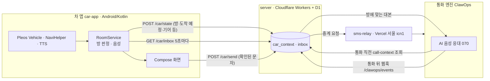

# 내비서 — 차 한 대, 세 개의 방

> 기어·내비 목적지·시각으로 지금 차가 **5분 사무실(정차) / 업무 운전 / 업무 시간 밖(퇴근길)** 중 어느 방인지 판정하고, 방에 맞게 차 화면·음성 안내·전화 응대 말투를 바꾸는 Pleos Connect 앱.

## 문제와 해결
| 문제 | 내비서의 해결 |
|---|---|
| 운전 중 업무 전화가 오면 받자니 위험하고, 안 받자니 상대가 기다린다 | 운전 중 못 받은 전화는 AI 비서가 대신 받아 "운전 중이라 정차 후 연락드리겠습니다"처럼 방에 맞게 응대하고 요약 카드로 남긴다 |
| 통신사 AI 비서는 내가 운전 중인지, 퇴근길인지 모른다 | 차 앱이 기어·목적지·도착 예정·운전 시간을 서버에 올리고, 통화 직전 서버가 그 상태로 응대 대본을 고른다 |
| 운전 중 화면을 들여다보면 위험하다 | 주행 중엔 상태 링·숫자와 음성 한 줄만. 카드 확인·문자 답장은 기어 P일 때만, 문자를 음성으로 보낼 땐 내용을 읽어 주고 "응"일 때만 |
| 운전 중 폰 메시지 알림을 볼 수 없다 | 차가 방·운전 상황으로 **언제·무엇을 읽을지** 정해 "카톡 3건, 김민수님 외 2명. 읽어드릴까요?"로 묻고, "읽어줘"·"답장, ○○라고 해 줘"·"나중에"로 답한다 |
| 퇴근 뒤에도 업무가 따라온다 | 퇴근길엔 급한 전화·바로 연결 번호만 알리고, 나머지와 "내일 아침에"로 미룬 카드는 다음 첫 업무 운전에 "어제 넘긴 전화 N건"으로 묶어 알린다 |
| 오래 운전하면 지친다 | 연속 운전 2시간이면 전화를 소리 없이 보관하고 업무 말은 "쉬고 나서"로 미룬다. 휴식 제안 때 앞쪽 졸음쉼터·휴게소를 내비 경유지로 넣는다 |

AI 비서는 첫 마디에 AI임과 내용을 기록해 전한다는 점을 밝히고, 약속 확정·회신 날짜·금액·운전자 위치는 말하지 않는다(서버 대본에 고정).

## 구성도

- 통화 음성은 차 앱이 아니라 통화 엔진(ClawOps 070 실통화 채널)이 처리한다(Pleos 공개 SDK에 통화 기능이 없음). 무엇을 말할지는 차가 올린 SDK 값이 정한다.
- 문자 발송은 Workers가 국외 IP라 통화 엔진이 막아서, 서울 리전 Vercel 함수(`sms-relay`)가 대신 보낸다.
- 파일별 역할과 데이터 흐름은 [docs/ARCHITECTURE.md](docs/ARCHITECTURE.md).

## Pleos SDK·차량 데이터 사용 표
모두 실제 코드에 있는 호출이다. 경로는 `car-app/app/src/main/java/ztw/carbiseo/` 기준.

| API | 어디에 쓰나 | 파일 |
|---|---|---|
| Vehicle `getGear().registerGearSelection` / `getCurrentGearSelectionState` | 방 판정의 핵심(P = 5분 사무실), 후진 중 음성 미루기, 카드 칩 "기어 D" | `CarAdapters.kt`, `RoomStateMachine.kt` |
| Vehicle `getTurnSignal().registerTurnSignalState` | 깜빡이 켜진 동안 음성 미루기 | `CarAdapters.kt`, `Drive.kt`(busyManeuver) |
| Vehicle `getSteeringWheel().registerSteeringWheelAngle` | 큰 조향 중 음성 미루기 | `CarAdapters.kt`, `Drive.kt` |
| Vehicle `getOdometer().getTrip{Current,Cumulative,SinceRefill}DrivingTime` + register | 피로 모드(장시간 운전이면 낭독 보관 + 휴게소 버튼), 응대 대본 "N시간 운전" | `CarAdapters.kt`, `Drive.kt`(TripDelta) |
| Vehicle `getSeat().registerSeatOccupancy` / `getCurrentSeatOccupancy` (조수석) | 동승자 감지 시 "동승자 모드로 바꿀까요?" 확인 | `CarAdapters.kt`, `Drive.kt`(SeatEdge) |
| Vehicle `getEvBattery().registerEvBatteryStateOfCharge` / `getEvBatteryStateOfCharge` | 서버로 보내는 차량 맥락(soc) | `CarAdapters.kt` |
| Vehicle `getSafety().getTelltalesInfo` | 빨간 경고등 안내(CAR_SAFETY로 30초마다 조회 시도. 에뮬은 PRIVATE_CAR_SAFETY가 없어 실패 → 조회 중단, 미실측) | `CarAdapters.kt`, `RoomService.kt` |
| NaviHelper `getDestinationInfo` / `onDestinationInfo`(좌표·이름·`remainTime`) | 목적지가 집·회사인지, 도착 예정 분 → 응대 대본·지각 예측·집 도착 5분 전 안내, 목적지 이름이 식당·주차장류면 예약 문자 초안 제안 | `CarAdapters.kt`, `Drive.kt`(homeSoon·lateBy·reservable) |
| NaviHelper `onCurrentLocationInfo` / `getCurrentLocationInfo` | 현재 위치(앞쪽 휴게소 고르기). FusedLocation은 쓰지 않는다 | `CarAdapters.kt`, `Drive.kt` |
| NaviHelper `onRouteCancelled` / `onRouteEnded` / `onDestinationChanged` / `onWaypointChanged` | 목적지 해제·갱신 | `CarAdapters.kt` |
| NaviHelper `getBookmarkInfo` / `onBookmarkInfo` (HOME·OFFICE) | 집·회사 좌표 자동 설정(회사가 목적지면 저녁에도 업무) | `CarAdapters.kt` |
| NaviHelper `getRecentDestinationInfo` / `onRecentDestinationInfo` | 집 즐겨찾기가 없을 때 이름이 "집"인 최근 목적지 | `CarAdapters.kt` |
| NaviHelper `requestRoute(RouteInfo)` | 정차 화면 일정 카드 "출발" → 그 장소로 경로 | `RoomService.kt` |
| NaviHelper `addWaypoint(RequestWaypointInfo)` | 휴식 제안(음성 "응" 또는 버튼)·"급해요" → 앞쪽 졸음쉼터·휴게소를 첫 경유지로 | `RoomService.kt` |
| NaviHelper `requestNavigationScreen(SearchPlace / AddHomeFavorite)` | 앞쪽 휴게소를 모를 때 내비 검색, 설정의 "내비 즐겨찾기에 집 추가" | `RoomService.kt` |
| NaviHelper `onCurrentRoadSpeedLimit` / `onCameraAlert` / `onCautionPointInfo` | 과속·주의 경고 테두리, 경고 중 음성 보류 | `CarAdapters.kt`, `Alert.kt` |
| TextToSpeech `Mode.ON_DEVICE` `speak` | 방 전환 안내, 부재중 한 줄 낭독, 휴식·집 문턱 안내, 폰 알림 묶음·낭독 (실패 시 Android TTS로 대체) | `Speaker.kt` |
| SpeechToText `Mode.ON_DEVICE` `request` / `ResultListener` (ko_KR) | 음성 대답: 폰 알림("읽어줘"·"답장 …라고 해 줘"·"응"·"나중에"), 지각 문자·회신 문자·예약 초안·휴식 경유지의 "응/아니", 정차 화면 [말하기]("아까 전화"·"다음 일정"·"급해요"). 안 되면 Android 인식 → P·저속 화면 버튼 | `Voice.kt`, `Notif.kt`, `RoomService.kt` |
| AAOS `CarUxRestrictionsManager` (리플렉션) | 주행 화면 제한(DO) 여부 → 방 판정 보조 | `CarAdapters.kt` |
| AAOS `CarPropertyManager` `PERF_VEHICLE_SPEED` | 속도(Pleos Vehicle SDK에 없음) → 과속 판정 | `CarAdapters.kt` |

의존성: `ai.pleos.playground:Vehicle:2.3.2`, `NaviHelper:3.0.5`, `TextToSpeech:3.3.1`, `SpeechToText:3.3.1`. 차량은 읽기만 하고 제어하지 않는다.

## 방 판정 규칙
`RoomStateMachine.kt`(순수 Kotlin, 단위 테스트 대상).

1. 기어가 P(또는 미확인)이고 주행 제한(DO)도 없으면 → **5분 사무실(PARK)**. 충전 중 읽기 API가 없어 충전도 P로 판단한다.
2. 주행 중이면 아래 중 하나라도 맞을 때 → **업무 시간 밖(DRIVE_REST)**, 아니면 **업무 운전(DRIVE_WORK)**
   - 주말(토·일)
   - 저녁~새벽(업무 끝 시각 이후 ~ 04시). 업무 끝 시각은 설정에서 17·18·19·20시, 기본 18시
   - 이른 아침(04시 ~ 업무 시작 07시)인데 목적지가 집(반경 300m)
   - 단, 목적지가 내비 즐겨찾기 '회사'면 시간과 무관하게 업무
3. 흔들림 방지: 주행 → P는 P가 2초 이어져야 전환, 전환 직후 300ms 안의 되돌림은 무시, 목적지가 사라져도 10초는 직전 목적지 유지(경유지 추가 때의 깜빡임 흡수).
4. 2분 미만 정차(신호 대기 등)는 같은 운전으로 본다 — 휴식 타이머·1회 안내를 리셋하지 않는다.

| 방 | 차 화면 | 새 전화 | AI 응대 말투 |
|---|---|---|---|
| 5분 사무실 | 받아 둔 전화 카드([완료]·[내일 아침에]·전화·문자), 일정 카드("지금 출발"), [말하기] | 소리 없이 카드 | "지금 잠시 자리를 비우셨어요"(저녁·새벽·주말 정차는 업무 시간 밖 대본) |
| 업무 운전 | 상태 링·급한 건 수·도착 예정 | 음성 한 줄 | "지금 운전 중이셔서 정차 후 연락드릴 거예요"(도착 예정이 있으면 "약 N분 뒤 도착하세요") |
| 업무 시간 밖 | 상태 링·다음 출근길에 알릴 건 수 | 급한 전화·바로 연결 번호만 음성 | "오늘 업무는 마치셨어요"(주말 "오늘은 쉬는 날이에요") + "말씀하신 내용 전해 드리겠습니다". 회신 날짜는 약속하지 않음 |

응대 방식은 "AI가 대신 받기"와 "한 마디 안내"(운전 중이라는 한 문장 + 도착 예정만 말하고 끊음) 2가지다. 바로 연결 번호(설정, 최대 10개)는 통화 중에 "바로 연결" 카드가 먼저 뜨고, 쉼·피로 중에도 차가 읽는다.

폰 알림: 업무 운전 = 광고((광고) 표기·이름에 '광고') 외 전부 묻기, 업무 시간 밖 = 설정의 즐겨찾기 보낸이만, 나머지는 세울 때 묶어서. 깜빡이·후진·큰 조향·경고·블루투스 통화·피로(2시간) 중이면 미뤘다가 풀리면 한 번에. 알림은 `phone-app/`(안드로이드 '내비서 연결', 알림 접근 권한)이 서버로 넘기고 답장도 그 알림의 답장 버튼으로 보낸다. 시연용으로 관리 페이지 '시험 알림 보내기'가 같은 경로에 넣는다.

## 실행 방법
### 1. 에뮬레이터
- Pleos Connect SDK Emulator(Android API 34 Pleos 이미지)를 실행한다.
- APK 설치: `adb install -r -g apk/내비서_내비서_release.apk`
- 차 화면 하단 앱 목록에서 **내비서**를 연다. 명령으로 열 땐 `adb shell monkey -p ztw.carbiseo -c android.intent.category.LAUNCHER 1`. 상단 알림에 "내비서 실행 중 — 방: ○○"이 뜨고, 내비를 앞에 띄워도 판정은 포그라운드 서비스에서 계속된다.
- 방 바꿔 보기: `adb forward tcp:8088 tcp:8088` 후 `http://127.0.0.1:8088/`(Virtual Console)에서 기어 P ↔ D, 내비에서 목적지를 집/다른 곳으로.
- 로그: `adb logcat -s ROOM ROOMADP`
- 부팅 직후 내비를 한 번도 열지 않았으면 첫 경로 요청이 무시될 수 있다. 앱이 내비를 깨운 뒤 다시 보내지만, 시연 전에 내비를 한 번 열어 두면 확실하다.

### 2. 차 앱 빌드
```
cd car-app
./gradlew testDebugUnitTest --max-workers=2
./gradlew assembleRelease --max-workers=2
```
- 저장소 루트 `.env`의 `CAR_TOKEN`이 BuildConfig로 들어간다(`.env.example` 참고). 없으면 서버 연동 없이 빌드된다.
- release 서명은 저장소 밖 `../현대차공모전_keys/keystore.properties`(storeFile·storePassword·keyAlias·keyPassword)를 읽는다. 없으면 서명 없이 빌드된다.
- minify(R8)는 끈다. Pleos SDK가 kotlin-reflect로 클래스 메타데이터를 읽기 때문이다.
- 디버그 빌드에만 시연용 브로드캐스트(`ztw.carbiseo.ALERT·TRIP·LOC·TIME·ROUTE·WP·SAY·HEAR·SIGNAL·SCREEN` 등)가 등록된다. release에서는 등록되지 않는다(`FLAG_DEBUGGABLE` 검사).

### 2-1. 휴대폰 연결 앱 (phone-app, 안드로이드 폰)
```
cd phone-app
./gradlew testDebugUnitTest assembleDebug --max-workers=2
```
- 차 앱과 같은 `.env`의 `CAR_TOKEN`이 BuildConfig로 들어간다. 설치 뒤 앱을 열면 '알림 접근 허용' 화면이 뜨고, '내비서 연결'을 켠다(adb: `cmd notification allow_listener ztw.carbiseo.phone/.Listener`).
- 디버그 빌드에만 답장 버튼이 있는 시험 메시지: `adb shell am broadcast -n ztw.carbiseo.phone/.TestSender --es from 김민수 --es text "회의 자료 보냈어요"`.

### 3. 서버 (Cloudflare Workers + D1)
```
cd server
npm test
npx wrangler@4 d1 execute carbiseo --remote --file=schema.sql   # 최초 1회
npm run deploy
```
- 배포 주소: `https://carbiseo-api.<계정>.workers.dev`(심사용 주소는 제출 메일에 별도 기재) · 데모 관리 페이지 `/admin`(Basic 인증)
- 비밀값(`wrangler secret put`): `CAR_TOKEN`, `ADMIN_TOKEN`, `CALL_CONTEXT_SECRET`, `OWNER_NUMBER`, `CLAWOPS_ACCOUNT_ID`, `CLAWOPS_API_KEY`, `CLAWOPS_NUMBER`, `CLAWOPS_SIGNING_KEY`, `SMS_RELAY_URL`, `SMS_RELAY_SECRET`
- 예약 작업: 매일 03시(KST) 보관 정책 실행.

### 4. 문자 중계 (Vercel, 서울 icn1)
- `sms-relay/`를 Vercel에 배포한다. 환경 변수: `RELAY_SECRET`, `CLAWOPS_ACCOUNT_ID`, `CLAWOPS_API_KEY`, `CLAWOPS_NUMBER`.

## 테스트
| 대상 | 명령 | 현재 |
|---|---|---|
| 차 앱 단위 테스트(방 판정·부재중·주행 기능·피로·지각·경고·도착 예정·배경·폰 알림·재현 통화) | `cd car-app && ./gradlew testDebugUnitTest --max-workers=2` | 135개 (11-01 전체 통과) |
| 서버(대본·서명 검증·관리자·보관 정책·요약·주인 통화·재현·중계·스위치·폰 알림·바로 연결·가족 문자·AI 문장 가드·카드 동작) | `cd server && npm test` | 86개 (11-02 전체 통과) |
| 휴대폰 연결 앱(메시지 알림 거르기·화면 로직) | `cd phone-app && ./gradlew testDebugUnitTest --max-workers=2` | 8개 (11-02 전체 통과) |

## 개인정보
- 음성은 우리 서버에 저장하지 않는다. 통화 엔진이 보낸 원문 기록은 7일 뒤 비우고, 요약 카드는 30일 뒤 삭제한다.
- 차 화면에는 발신 번호 끝 4자리와 요약만 보인다. 문자 중계 응답에서도 번호를 가린다.
- AI가 만든 요약·할 일 문장은 저장 전에 120자·금칙어·전화번호 검사를 거치고, 걸리면 고정 문구로 바꾼다(`server/src/guard.ts`). 사용자가 확인한 문자·메일 본문은 금칙어가 있으면 보내지 않는다.
- 통화 엔진(ClawOps) 쪽에는 통화 녹음이 남는다. 녹음 끄기 설정이 없고, 통화 뒤 자동 삭제는 아직 연결하지 않았다.

## APK
`apk/내비서_내비서_release.apk` (release 빌드, minSdk 28 / targetSdk 34, applicationId `ztw.carbiseo`)

권한: `STT_SERVICE`, `RECORD_AUDIO`, `CAR_DRIVE`, `CAR_LIGHTS`, `CAR_SEATS`, `CAR_ENERGY`, `CAR_SAFETY`, `NAVI_ROUTE`, `NAVI_ROUTE_SEARCH`, `NAVI_CUSTOM_MAP`, `TTS_SERVICE`, `CAR_SPEED`, 포그라운드 서비스, 알림, 부팅 완료, 인터넷.

## 알려진 제약
- **주행 중 화면 가림**: 에뮬레이터는 기어 D에서 앱 화면을 가린다(주행 제한). 그래서 휴식 제안 버튼은 주행 중 음성 안내까지만 확인했고, 버튼 탭은 에뮬에서 직접 누르지 못했다.
- **트립 주행시간 미지원**: 에뮬에서 `getTrip*DrivingTime` 3종이 모두 `ERROR_NOT_SUPPORTED_PROPERTY`. 앱이 잰 연속 운전 시간으로 대신하고, 실차에서 SDK 값이 오면 그것을 우선 쓴다(단위는 실차에서 확정).
- **경고등**: 코드는 `CAR_SAFETY` 권한으로 `getTelltalesInfo`를 30초마다 조회하려 하지만, 에뮬에서는 `PRIVATE_CAR_SAFETY` 권한이 없어 SecurityException으로 실패하고 조회를 멈춘다. 그래서 경고등 안내는 실측하지 못했다.
- **음성 인식**: SpeechToText는 기기 안(ON_DEVICE) 모드만 쓴다(서버 모드는 콘솔 '준비 중'). 로캘을 `ko`로 주면 엔진이 거절해 `ko_KR`(Locale.KOREA)로 준다(TTS도 같이 바꿔 에뮬 엔진 오류가 사라짐). 에뮬에서는 녹음된 음성 파일을 넣어 "읽어줘" 인식을 확인했지만 결과가 불안정했고(4번 중 1번), 10-31 재시험에서는 결과가 오지 않았다. 실제 마이크 음성은 확인하지 못했다. 대화 흐름은 인식 결과를 디버그로 넣어(`SAY`) 확인했고, 시연 영상에도 그렇게 표기한다.
- **폰 알림**: 아이폰은 다른 앱 알림을 읽을 수 없어(애플 정책) 안드로이드 폰만. 메시지 답장은 그 알림이 폰에 떠 있어야 보낼 수 있다.
- **휴게소 목록**: NaviHelper에 장소 검색 API가 없어 졸음쉼터 253곳·고속도로 휴게소 92곳(일부 근사 좌표) 목록(`assets/reststops.tsv`)을 앱에 넣어 둔다. 휴게소 좌표는 공식 좌표 파일이 없어 OpenStreetMap에서 가져왔다.
- **충전 중 판정**: SDK에 충전 중 읽기 API가 없어 기어 P로만 판단한다.
- **동승자 감지**: 에뮬의 조수석 착석 값이 반대로 오는 것으로 보여, 자동 전환 대신 확인 버튼 1번을 거친다.
- **착신 전환·070**: 010 무응답 → 서비스 070 착신 실통화(통신사 조건부 착신전환)와 발신번호 전달은 검증하지 못했다(2차에서 시연). 070 체험 기간(10-29~11-01)에 실제 AI 통화는 녹음했지만 유료 전환 전이라, 1차 시연의 전화 장면은 그 녹음 편집과 관리 페이지의 재현 주입이다.
- **2차 예정**: 목적지 식당·주차장에 AI가 직접 거는 예약 전화(지금은 예약 문자 초안까지, 070 유료 필요), 실통화 중 도움 카드(지금은 관리 페이지 재현 통화), 회전 직전 음성 미루기(`onTBTInfo`), 실제 캘린더 연결(지금은 데모 일정).
- **블루투스 통화 중 낭독 보류**: `AudioManager` 모드로 판단하며 실차에서 확인하지 않았다.

## 데이터·오픈소스 출처
- 졸음쉼터: 한국도로공사 전국졸음쉼터표준데이터 (data.go.kr 15028203, 데이터기준일자 2026-02-25, 이용허락범위 제한 없음)
- 고속도로 휴게소 이름: 한국도로공사 휴게소 현황 (data.go.kr 15164198, 2026-08-28)
- 휴게소 좌표: © OpenStreetMap contributors, Open Database License(ODbL) — https://www.openstreetmap.org/copyright
- 차량·내비·음성 기능: Pleos SDK(현대자동차그룹) — 공모전 제공 SDK 약관에 따름
- 주요 라이브러리(Gradle 의존성): Jetpack Compose(BOM 2024.09.03)·Material3·Activity Compose 1.9.3·Kotlin 1.9.25 — Apache License 2.0 / JUnit 4.13.2(테스트 전용) — Eclipse Public License 1.0
